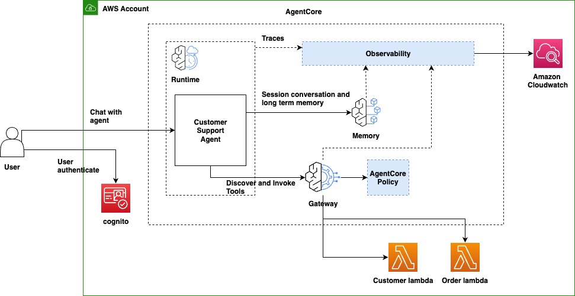

# Financial Assistant on Amazon Bedrock AgentCore

A retail-banking assistant that answers questions about a customer's accounts, balances, card
transactions and spending, opens disputes, and moves money between the customer's own accounts.
It runs on **Amazon Bedrock AgentCore** (Runtime, Gateway, Memory, Policy Engine) with a
[Strands](https://strandsagents.com) agent on **DeepSeek V3.2** (`deepseek.v3.2`, us-east-1).



| Component | Role |
|---|---|
| **AgentCore Runtime** | Hosts the containerized agent (arm64) behind a Cognito JWT authorizer |
| **AgentCore Gateway** | MCP endpoint for the 8 banking tools; forwards the user's token and checks the `gateway:invoke` scope |
| **AgentCore Policy Engine** | Cedar policies on `cognito:groups` and tool arguments (for example, dispute and transfer limits) |
| **AgentCore Memory** | Per-user facts, preferences, session summaries and episodes (`financialAssistant_Memory`) |
| **Amazon Cognito** | Sign-in; access tokens carry `sub`, the username (the email) and `cognito:groups` |
| **AWS Lambda** | One function with the mock banking APIs, shared by both Gateway targets |
| **Amazon CloudWatch** | OpenTelemetry traces, logs and metrics; AgentCore built-in evaluations read the traces |

Safety is layered: the system prompt sets the rules, a code-level gate makes disputes and transfers
wait for an explicit "yes" in a separate turn, and the Policy Engine enforces limits at the Gateway,
outside the model. See [docs/architecture.md](docs/architecture.md).

## Repository layout

```
.
├── src/financial_assistant/     # the agent (container image)
│   ├── main.py                  #   AgentCore Runtime entrypoint
│   ├── auth.py                  #   caller identity from the Cognito JWT
│   ├── prompts.py               #   system prompt
│   ├── guardrails.py            #   confirmation gate for disputes and transfers
│   ├── streaming.py             #   strips DeepSeek's leaked tool-call markup from the stream
│   ├── memory.py                #   AgentCore Memory session manager
│   ├── gateway.py               #   MCP client for the AgentCore Gateway
│   ├── model.py                 #   Bedrock model
│   └── config.py                #   settings from the Runtime's environment
├── lambdas/banking_tools/       # banking tools behind the Gateway (one Lambda)
├── infra/                       # AWS CDK app (TypeScript): image, Runtime, Gateway, Memory, Cognito
├── scripts/                     # deploy, teardown, Cognito users/login, observability, model check
├── ui/                          # Streamlit chat UI (Cognito sign-in, calls the deployed Runtime)
├── evals/                       # evaluation conversations + runner (AgentCore built-in evaluators)
├── tests/unit/                  # pytest: agent modules and Lambda tools
├── docs/                        # architecture, Policy Engine, EC2 runbook, troubleshooting
├── Dockerfile                   # arm64 image, dependencies from uv.lock
├── pyproject.toml / uv.lock     # Python project and locked dependencies
└── Makefile                     # shortcuts: install, lint, test, synth, deploy, eval
```

## Prerequisites

- An **arm64** build machine (AgentCore Runtime only runs arm64 images). The reference setup is an
  Amazon Linux 2023 **t4g.medium** EC2 instance in **us-east-1**.
- [uv](https://docs.astral.sh/uv/getting-started/installation/), Node.js 20+, Docker, AWS CLI v2.32+.
- AWS credentials with permission to deploy CDK stacks (Lambda, Cognito, ECR, IAM, AgentCore).
- Amazon Bedrock model access to **DeepSeek V3.2** in the deployment Region.

The full step-by-step guide, including setting up the EC2 instance from scratch, is
[docs/runbooks/commands_ec2.txt](docs/runbooks/commands_ec2.txt).

## Quick start

```bash
scripts/deploy.sh                                    # checks, uv sync, npm ci, cdk bootstrap + deploy
uv run scripts/cognito-user.py --create              # pick john@example.com (add --group premium for jane)
eval $(uv run scripts/cognito-user.py --login --export)   # opens Cognito login, sets the bearer token
uv run agentcore invoke -s $(python3 -c "import uuid;print(uuid.uuid4())") '{"prompt": "What are my balances?"}'
```

Later deploys after a code change:

```bash
cd infra && npx cdk deploy --all --outputs-file ../cdk-outputs.json --require-approval never
```

Chat UI (needs only `cdk-outputs.json` and a Cognito user, no AWS credentials):

```bash
make ui        # then open http://localhost:8501; on EC2 forward ports 3000 and 8501 over SSH
```

Step-by-step: [docs/runbooks/ui_guide.txt](docs/runbooks/ui_guide.txt).

The login needs port 3000 forwarded to the machine running the script
(`ssh -L 3000:localhost:3000 ...`). Mock customers are `john@example.com` (CUST-001) and
`jane@example.com` (CUST-002).

## Configuration

The CDK stack sets these on the Runtime; nothing is hard-coded in the agent.

| Variable | Set from | Purpose |
|---|---|---|
| `MODEL_ID` | `cdk deploy -c modelId=...` (default `deepseek.v3.2`) | Bedrock model |
| `GATEWAY_URL` | Gateway resource | MCP endpoint for the tools |
| `BEDROCK_AGENTCORE_MEMORY_ID` | Memory resource | Memory used for this user's sessions |
| `AWS_REGION` | Stack Region | Bedrock and Memory Region |
| `LOCAL_DEV=1` | set by hand | Run the agent without a Gateway (no tools) |

## Development

```bash
make install       # uv sync --locked + npm ci (infra)
make check         # ruff lint + format check, tsc, pytest, CDK template tests
make synth         # cdk synth, no Docker needed
```

CI (`.github/workflows/ci.yml`) runs the same checks on every push and pull request. The CDK tests
also check that every tool schema the Gateway exposes has a handler in the Lambda.

## Policies, observability and evaluations

- **Policy Engine:** Cedar policies are created in the console; see [docs/policy-engine.md](docs/policy-engine.md).
- **Observability:** `uv run scripts/observability.py setup` turns on CloudWatch Transaction Search
  and Gateway/Memory log and trace delivery; `check` reports what is flowing.
- **Evaluations:** `uv run evals/run_eval.py` runs the conversations in `evals/cases.json` and scores
  them with AgentCore built-in evaluators, or score one session with
  `uv run agentcore eval run -s <session-id> -e Builtin.GoalSuccessRate ...`.

## Cleanup

```bash
scripts/teardown.sh
```

Detach and delete the Policy Engine in the console first. `scripts/observability.py teardown`
removes the log deliveries that setup created.

## Documentation

| Document | Contents |
|---|---|
| [docs/architecture.md](docs/architecture.md) | Components, request flow, code map, safety layers, design decisions |
| [docs/policy-engine.md](docs/policy-engine.md) | Creating the Cedar policies and attaching them to the Gateway |
| [docs/runbooks/commands_ec2.txt](docs/runbooks/commands_ec2.txt) | End-to-end EC2 guide, every command in order |
| [docs/runbooks/troubleshooting.md](docs/runbooks/troubleshooting.md) | Known errors and fixes |
| [infra/README.md](infra/README.md) | CDK stacks and commands |
| [lambdas/README.md](lambdas/README.md) | Banking tools and how to add one |
| [CHANGELOG.md](CHANGELOG.md) | Release history |
