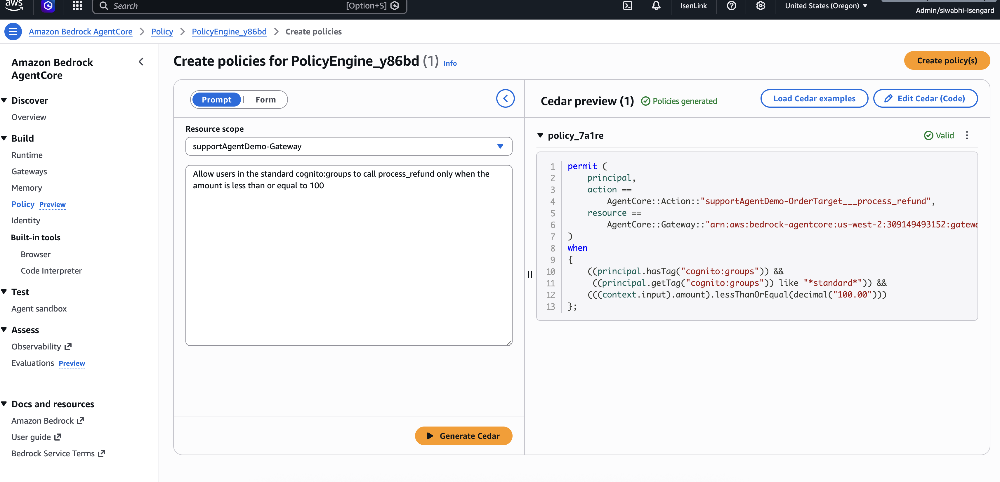
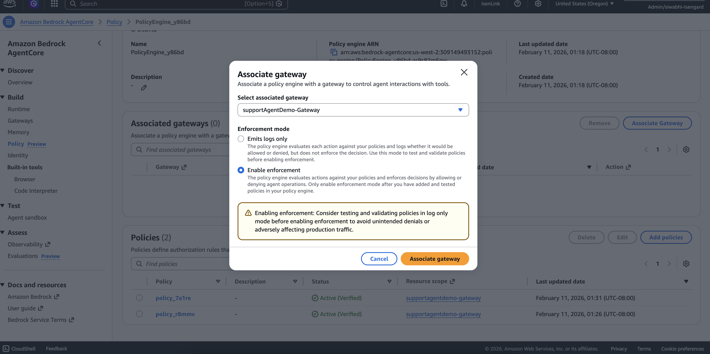

# AgentCore Policy Engine (Cedar)

Policies decide, for every tool call at the Gateway, whether it may run. They see the caller's JWT
claims (such as `cognito:groups`) and the tool's arguments (such as `amount`). Because they run in
the Gateway, outside the model, a jailbroken or confused agent cannot get around them.

The Policy Engine is created in the console; the CDK stack only grants the Gateway role the
`GetPolicyEngine`, `AuthorizeAction` and `PartiallyAuthorizeActions` permissions it needs.

## 1. Create the policy engine

AWS console → **Amazon Bedrock AgentCore** (us-east-1) → **Policy** → **Create policy engine**.
Name it, for example `supportAgentDemoPolicy`.

## 2. Add the policies

Open the engine → **Create policy**, choose the `supportAgentDemo-Gateway` resource scope, type each
sentence, click **Generate Cedar**, then **Create policy**:

1. `Allow all authenticated users to call find_customer, get_customer, list_accounts, list_transactions, get_transaction, and get_spending_summary`
2. `Allow users in the standard cognito:groups to call dispute_transaction only when the amount is less than or equal to 100`
3. `Allow users in the standard cognito:groups to call transfer_funds only when the amount is less than or equal to 1000`
4. Optional, so premium users such as Jane can act too:
   `Allow users in the premium cognito:groups to call dispute_transaction and transfer_funds only when the amount is less than or equal to 5000`



Once enforcement is on, anything no policy allows is denied. Without policy 4, premium users cannot
dispute or transfer at all.

## 3. Attach it to the Gateway

**Associate gateway** → `supportAgentDemo-Gateway` → enforcement mode:

- **Enable enforcement**: denies calls the policies do not allow. Use this one.
- **Emits logs only**: test mode. Decisions are logged, nothing is blocked.



Policies take effect immediately; no redeploy is needed.

## 4. Verify

```bash
O(){ python3 -c "import json,sys;print(json.load(open('cdk-outputs.json'))['supportAgentDemo-AgentCoreStack'][sys.argv[1]])" "$1"; }
aws bedrock-agentcore-control list-policy-engines --region us-east-1 --output table
aws bedrock-agentcore-control get-gateway --region us-east-1 --gateway-identifier $(O GatewayId) --query policyEngineConfiguration
```

Then, logged in as john@example.com (standard), in one session:

| Prompt | Then | Expected |
|---|---|---|
| "Dispute the duplicate 15.99 StreamFlix charge." | "Yes" | Allowed, a `DSP-…` ID |
| "I don't recognise the 399 dollar QUICKPAY charge. Please dispute the full amount." | "Yes" | Denied by policy (> $100) |
| "Move 1500 dollars from savings to checking." | "Yes" | Denied by policy (> $1,000) |

The agent reports a denial as returned and does not retry or split the amount. In CloudWatch, the
trace for the denied call shows the policy decision.

## Remove

Disassociate the gateway, delete the policies, then delete the engine (all in the console). Do
this before `scripts/teardown.sh`.
